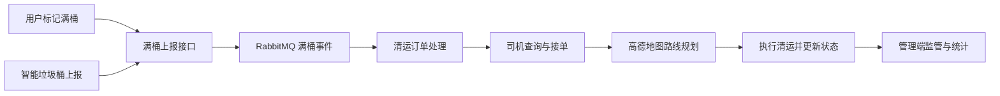

# SmartWaste

**面向新型服务模式的垃圾分类回收运输监管系统**

SmartWaste 面向居民分类投放、司机清运和管理人员监管三个场景，围绕垃圾拍照识别、投放点查询、满桶上报、清运订单、路线规划和智能问答，组织从投放到清运的完整业务流程。

用户通过拍照判断垃圾类别、查找投放点并标记满桶；系统同时接收智能垃圾桶的满桶数据，生成清运任务；司机接单后规划路线并完成运输，管理端统一查看订单、车辆位置及清运路线。

## 功能概览

| 使用端 | 主要功能 |
| --- | --- |
| 用户端 | 注册登录、拍照识别、分类投放、投放点查询、满桶标记、清运记录、智能客服 |
| 司机端 | 登录、待清运订单查询、接单与状态更新、路线规划、位置上报、新订单提醒 |
| 管理端 | 员工及司机管理、订单管理、车辆定位、路线展示、统计及超时任务提醒 |
| 设备接入 | 接收智能垃圾桶的状态与满桶数据，与用户手动上报统一处理 |

### 拍照识别与分类投放

接入百度 EasyDL 图像分类接口，接收用户上传的垃圾照片，解析并返回垃圾类别，辅助用户分类投放。识别应用凭据及模型地址按部署环境配置。

### 登录与投放点查询

- 使用 Access Token / Refresh Token 双令牌认证，结合 Redis 黑名单管理失效令牌。
- 采用 Caffeine + Redis 二级缓存存储投放点位置、可投放类型等基础信息，减少重复查询产生的数据库访问。
- 将投放点基础资料与满桶状态、车辆位置等动态数据分别处理，按业务要求更新。

### 满桶上报与订单并发

- 统一接收用户标记与设备满桶上报，通过 RabbitMQ 解耦事件接收与清运订单生成。
- 通过发送确认、消费确认及业务唯一键处理消息重试与重复消费。
- 围绕同一垃圾桶的有效清运任务进行业务防重，结合 Redisson、Lua 与数据库乐观锁处理重复建单及并发接单冲突。
- 订单创建后供司机查询、接单，通过 WebSocket 向在线司机发送新订单提醒。

### RAG 智能客服

将垃圾分类规则、投放常识、智能垃圾桶使用说明分块存储，支持“某种垃圾属于哪一类”“智能垃圾桶如何使用”等用户问答。

检索流程采用 Elasticsearch BM25 与 Chroma 向量检索多路召回，通过 RRF 融合及 Reranker 精排选择相关资料，再由 Spring AI 组织模型调用和回答生成。

### 运输与监管

- 对接高德地图 API，规划投放点至垃圾站的清运路线。
- 接收司机端的车辆定位上报，在管理端地图中展示车辆位置与路线。
- 通过 WebSocket 向管理端监控页面推送车辆位置和订单状态。
- 定时扫描超时未接订单，辅助管理人员跟进清运任务。

## 业务流程



消息队列承载满桶事件，订单创建及状态变更由后端业务代码完成。WebSocket 用于在线提醒和状态更新；司机重新上线后仍通过订单接口查询待处理任务。

## 技术组成

| 层次 | 技术与用途 |
| --- | --- |
| 后端 | Java、Spring Boot、MyBatis / MyBatis-Plus |
| 数据存储 | MySQL：用户、司机、订单、分类及路线等业务数据 |
| 认证与缓存 | 双令牌、Redis 黑名单、Caffeine、Redis |
| 异步与并发 | RabbitMQ、Redisson、Lua、数据库乐观锁 |
| 智能问答 | Spring AI、Elasticsearch BM25、Chroma、RRF、Reranker |
| 实时通信 | WebSocket、定时任务 |
| 外部服务 | 百度 EasyDL、高德地图 API |
| 页面 | Vue、Element UI、Vant、HTML / CSS / JavaScript |

## 目录结构

```text
SmartWaste/
├── pom.xml
├── src/main/java/com/example/shizhan/rubbish/
│   ├── controller/android/   用户端、司机端相关接口
│   ├── controller/web/       管理端相关接口
│   ├── service/              业务逻辑
│   ├── mapper/               数据访问
│   ├── entity/               数据模型
│   ├── config/               Web 与持久层配置
│   ├── common/               响应封装、异常处理与上下文
│   └── utils/                HTTP、图像编码等工具
├── src/main/resources/
│   ├── application.yml
│   └── static/
│       ├── backend/          管理端页面
│       ├── android/user/     用户端页面
│       ├── android/driver/   司机端页面
│       └── front/            移动端基础页面与组件
└── src/test/
```

## 本地运行

### 准备环境

准备与 `pom.xml` 编译配置匹配的 JDK、Maven、MySQL，以及 Redis、RabbitMQ、Elasticsearch、Chroma、模型与重排服务。创建业务数据库并准备与实体对应的表结构，申请自己的百度 EasyDL 与高德地图应用配置。

### 配置连接参数

数据库和 EasyDL 凭据通过进程环境变量注入，示例见 [`.env.example`](.env.example)。Spring Boot 不会自动加载该示例文件，需要在启动环境中设置变量。

```powershell
$env:SMARTWASTE_DB_URL = 'jdbc:mysql://127.0.0.1:3306/smart_waste?serverTimezone=Asia/Shanghai&useUnicode=true&characterEncoding=utf-8'
$env:SMARTWASTE_DB_USERNAME = 'smartwaste'
$env:SMARTWASTE_DB_PASSWORD = 'your-database-password'
$env:BAIDU_API_KEY = 'your-baidu-api-key'
$env:BAIDU_SECRET_KEY = 'your-baidu-secret-key'
$env:BAIDU_CLASSIFICATION_URL = 'https://aip.baidubce.com/rpc/2.0/ai_custom/v1/classification/your-model-name'
```

地图页面使用自己的高德 JS API 配置及访问域名。其他服务的地址、模型名、消息队列与向量库连接参数按实际环境填写。

### 构建与启动

```bash
cd SmartWaste
mvn clean package -DskipTests
mvn spring-boot:run
```

默认端口为 `8080`，可用 `SMARTWASTE_PORT` 调整。页面入口：

- 管理端：`http://localhost:8080/backend/index.html`
- 用户端：`http://localhost:8080/android/user/index/login.html`
- 司机端：`http://localhost:8080/android/driver/index/login.html`

## 关键设计

1. **同一轮清运只产生一个有效任务**：用户与设备重复上报时按业务防重，清运结束后允许下一轮满桶创建新订单。
2. **订单落库后确认消息**：消费端完成数据库事务后确认处理完成，对重复投递进行幂等处理。
3. **接单状态受控变更**：在待接单转为运输中时进行并发校验，避免多个司机取得同一任务。
4. **问答知识可维护**：分类规则、设备说明和投放常识按文档更新，检索结果作为回答依据。
5. **基础信息与动态信息分离**：基础资料适合缓存，满桶状态与车辆定位按实时性要求更新。

## 第三方资源

Vue、Element UI、Vant、地图 SDK 等第三方组件遵循各自许可证。外部 AI 和地图服务使用部署者自己的应用配置。
